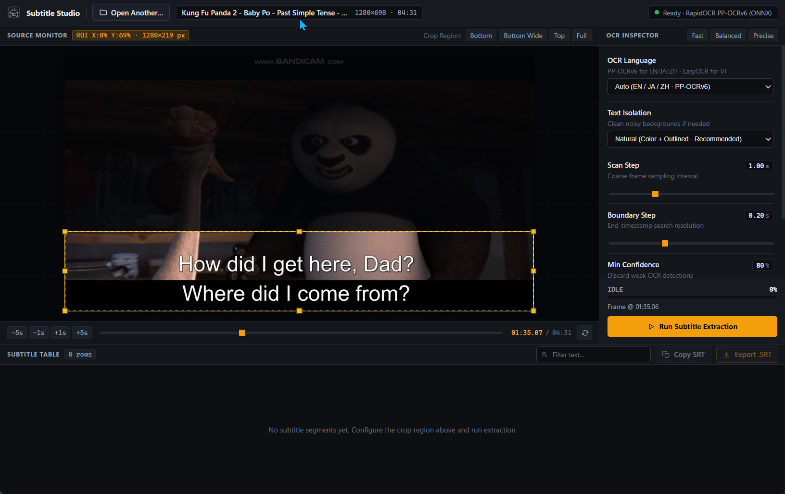

# Subtitle Studio

Subtitle Studio is a Windows desktop application that extracts hardcoded subtitles from video files into `.srt` subtitles using a hybrid Go + Python + React pipeline:

- **React (Wails Frontend)**: Video preview, interactive ROI crop selection, scan presets, progress monitoring, and inline SRT editing.
- **Go (Wails Backend)**: Job lifecycle management, Go-to-Python JSON-lines worker bridge, cancellation support, and `.srt` formatting/export.
- **Python Engine**: OpenCV frame analysis paired with hybrid **RapidOCR** (PP-OCRv6 / PP-OCRv5) and **EasyOCR** (CUDA-accelerated when configured).



---

## Core Idea

The expensive operation in subtitle extraction is OCR. A naive implementation that runs OCR on every sampled video frame wastes substantial GPU/CPU time, because the same subtitle typically stays visible on screen across many consecutive samples.

This project separates the problem into two stages:

1. Use lightweight image math to detect when a subtitle appears and disappears.
2. Run OCR once per detected subtitle segment, using batches (`OCR_BATCH_SIZE = 8`).

This means the system does not ask an OCR model to solve a timing problem that can be handled orders of magnitude faster with pixel and edge comparison.

---

## Subtitle Detection Workflow

For a video of duration $T$, the main scan loop samples frames at `step_sec`:

```text
video -> sample frame -> crop subtitle region -> has_text()
                                                   |- no candidate -> next sample
                                                   '- candidate -> _find_t_end() -> 3-frame median -> OCR batch
```

The scan loop and OCR inference run as overlapping pipeline stages via a background worker thread (`ThreadPoolExecutor`). Once a batch of crops is submitted to the OCR worker, the main loop immediately continues scanning, filtering with `has_text()`, and refining boundaries instead of stalling for OCR to finish:

$$
T_{serial} = T_{scan} + T_{ocr}
$$

$$
T_{pipeline} \approx \max(T_{scan},\; T_{ocr})
$$

Because OCR inference is much slower than OpenCV edge comparison, fast frame scanning is largely hidden inside the OCR latency rather than stacking sequentially on top of it.

### 1. Crop the Configured Region

The frontend sends normalized coordinates:

```text
crop_box = (x_min, x_max, y_min, y_max)
```

Each value is in $[0, 1]$. For a frame of width $W$ and height $H$:

```text
x_start = W * x_min
x_end   = W * x_max
y_start = H * y_min
y_end   = H * y_max
```

Only this cropped band enters the detection, timing, and OCR stages.

### 2. Cheap Candidate Filtering with `has_text()`

`SubtitleOCR.has_text()` is a lightweight OpenCV gate. It never invokes RapidOCR or EasyOCR. It combines:

- Grayscale conversion (`BGR -> GRAY`);
- Canny edge detection (`85, 185`) to target crisp character strokes rather than flat bright blobs (shirts, sky, or light panels);
- Horizontal `3x1` morphological dilation to bridge closely spaced letter strokes;
- Active-row counting across the crop height.

Frames without sufficient text-like edge density are discarded immediately before timing comparison or OCR.

### 3. Capture the Anchor Frame

When `has_text()` triggers at timestamp $t_{start}$, its crop becomes the visual reference anchor $A$:

```text
A = anchor crop at t_start
```

### 4. Build the Text-Focused Anchor Signature

`MathEngine.compute_anchor_signature()` converts $A$ to grayscale and extracts edges $E_A$:

$$
G_A = \text{Gray}(A)
$$

$$
E_A = \text{Canny}(G_A, 90, 180) \cap \text{Dilate}_{7\times 7}(G_A \ge 165)
$$

When at least $15$ edge pixels fall inside the bright-stroke band ($G_A \ge 165$), $E_A$ isolates subtitle outlines instead of background clutter (otherwise full Canny edges are used). The total anchor edge count is:

$$
N_E = \sum_{x,y} E_A(x,y)
$$

If $N_E < 10$, the candidate has insufficient visual structure and is rejected.

### 5. Track Subtitle Boundaries Without OCR

For each subsequent crop $F_t$ sampled every `boundary_step` seconds (default `0.10s`, stepping sequentially via `cap.grab()`), `MathEngine` converts it to grayscale:

$$
G_t = \text{Gray}(F_t)
$$

and measures the absolute pixel difference against the anchor:

$$
D_t(x,y) = |G_A(x,y) - G_t(x,y)|
$$

With the current threshold $\tau = 26$, pixels whose difference stays within tolerance form the static mask $M_t$:

$$
M_t(x,y) = \begin{cases} 1 & \text{if } D_t(x,y) \le 26 \\ 0 & \text{otherwise} \end{cases}
$$

The two grayscale subtitle crops being compared behave like this:


Comparison is restricted to the anchor edge mask $E_A$, combined with a symmetric guard against newly appearing caption strokes on changed pixels:

$$
S_t = \frac{\sum_{x,y} E_A(x,y) \cdot M_t(x,y)}{N_E}
$$

$$
N_{\text{new}} = \sum_{x,y} \left( E_t(x,y) \cdot (1 - M_t(x,y)) \right)
$$

The current decision rule for keeping a subtitle active is:

```text
S_t > 0.45  AND  N_new <= max(200, int(0.85 * N_E))  -> subtitle is still the same
Otherwise                                            -> subtitle changed or disappeared (lock t_end)
```

Restricting $S_t$ to $E_A$ prevents moving background behind static text from falsely splitting a caption, while checking $N_{\text{new}}$ catches rapid subtitle replacements that happen to share bright pixels in the same region.

### 6. Select Representative Frame & Batch OCR After Timing

Instead of running OCR on the very first anchor frame (which may still be fading in or noisy), `_select_representative_crop()` keeps up to $12$ stable frames across $[t_{start}, t_{end}]$ and computes the pixel-wise median of the `25%`, `50%`, and `75%` samples.

Once `(t_start, t_end, representative_crop)` is finalized, it is pushed to `pending_ocr`. Crops are processed in batches of $B = 8$ (`OCR_BATCH_SIZE`):

```text
pending crops (B = 8) -> optional bright-text isolation -> RapidOCR / EasyOCR -> confidence & text filter -> fuzzy merge
```

Consecutive cues separated by tiny gaps (`<= max(0.6 * step_sec, 3 * boundary_step, 0.35s)`) with normalized text similarity $\ge 0.84$ are merged automatically, emitting clean segments of the form:

```json
{
  "start": 12.2,
  "end": 14.0,
  "text": "Example subtitle"
}
```

---

## Why This Reduces OCR Time

Let:

- $N$ = number of sampled frames checked across the video
- $K$ = number of detected subtitle segments
- $B$ = OCR batch size (currently $8$)
- $C_{\text{ocr}}$ = cost of one OCR inference call
- $C_{\text{math}}$ = cost of OpenCV grayscale, diff, and edge checks

A **naive approach** that executes OCR on every sampled frame pays approximately:

$$
T_{\text{naive}} \approx N \cdot C_{\text{ocr}}
$$

This workflow reduces total work to:

$$
T_{\text{current}} \approx N \cdot C_{\text{math}} + \left\lceil\frac{K}{B}\right\rceil \cdot C_{\text{ocr}}
$$

Because typically $K \ll N$ and $C_{\text{math}} \ll C_{\text{ocr}}$, expensive recognition runs only once per distinct subtitle cue and is amortized into GPU/ONNX batches. A representative stage timing breakdown looks like:

| Stage | Share |
|---|---:|
| Frame positioning (`position`) | 0.8% |
| Fast text candidate filter (`has_text`) | 0.7% |
| Subtitle end detection (`find_t_end`) | 12.7% |
| Batched OCR (`read_text`) | 85.8% |
| **Total** | **100%** |

This profile shows why avoiding per-frame OCR and batching `read_text` calls delivers the largest speedup: frame seeking and pixel math remain minor overhead while recognition accounts for the vast majority of execution time (exact proportions vary with video resolution, GPU, subtitle density, and language engine).

---

## Features & Language Routing

- **Interactive Frame & ROI Monitor**: Seek or step (`-5s`, `-1s`, `+1s`, `+5s`) through video frames immediately at startup while OCR models finish loading in the background; includes `Bottom`, `Bottom Wide`, `Top`, and `Full` crop presets.
- **Multilingual Hybrid OCR**:
  - **Auto / English / Japanese / Chinese**: `RapidOCR` with **PP-OCRv6** (`det_small` + `rec_medium` via ONNX Runtime).
  - **Korean**: `RapidOCR` with **PP-OCRv5 Korean**.
  - **Vietnamese + English**: **PP-OCRv6** line detector combined with **EasyOCR** (`vi`, `en`) recognition (CUDA GPU when available).
- **Preprocessing Modes**: `Natural` (recommended for colored or clean subtitles) and `Isolate Bright Text` (HSV bright-stroke + dark-halo component filtering for cluttered backgrounds).
- **Inline Subtitle Editor**: Seek directly to any cue's timestamp, edit text inline, filter or merge cues, and export `.srt`.

---

## Project Structure

```text
SRT getter/
├── app.go                         # Wails bound methods, validation, job state, SRT export
├── main.go                        # Wails window setup and embedded frontend assets
├── worker.go                      # Go <-> Python subprocess & JSON-lines bridge
├── srt.go                         # SRT formatting and file export
├── wails.json                     # Wails build configuration
├── build/
│   ├── appicon.png                # Application icon (1024x1024)
│   └── windows/                   # Windows icon, manifest, and metadata
├── docs/
│   ├── subtitle-studio.gif        # Application demo recording
│   └── grayscale-subtitle-frame.svg
├── engine/
│   ├── worker.py                  # Persistent JSON-lines worker (async model init + jobs)
│   ├── algorithm.py               # Scan loop, boundary tracking, 3-frame median, batching, merge
│   ├── math_engine.py             # Text-focused edge signature and symmetric comparison
│   ├── requirements.txt           # Python engine dependencies
│   └── models/
│       └── ocr_engine.py          # Hybrid RapidOCR (PP-OCRv6/v5) + EasyOCR wrapper
└── frontend/
    ├── package.json
    ├── public/favicon.svg
    └── src/
        ├── App.tsx                # Studio UI, ResizeObserver ROI monitor, inline SRT table
        ├── styles.css
        ├── types.ts
        └── wails.d.ts
```

---

## Installation (Windows)

### Prerequisites

- **Go**: `1.25` or newer
- **Node.js & npm**: Node `18+` (tested with Node `24` / npm `11`)
- **Python**: `3.10` – `3.13` (64-bit)
- **Microsoft Edge WebView2 Runtime**: Pre-installed on Windows 10/11
- **NVIDIA Driver & CUDA PyTorch** *(optional)*: Only needed for GPU acceleration in EasyOCR (`Vietnamese` mode). `RapidOCR` runs via ONNX Runtime without requiring CUDA PyTorch.

### 1. Set Up the Python Environment

From the project root:

```powershell
python -m venv .venv
.\.venv\Scripts\Activate.ps1
python -m pip install --upgrade pip
```

#### Optional: Install CUDA PyTorch (for GPU EasyOCR)

If you use an NVIDIA GPU, install **both `torch` and `torchvision`** from the PyTorch CUDA index **before** installing `engine\requirements.txt`. Installing `easyocr` directly from PyPI first will pull CPU-only PyTorch wheels and cause automatic fallback to CPU.

For CUDA 12.8:

```powershell
python -m pip install --force-reinstall torch torchvision --index-url https://download.pytorch.org/whl/cu128
```

Verify CUDA is active:

```powershell
python -c "import torch; print(torch.__version__, torch.version.cuda, torch.cuda.is_available())"
```

Expected output ends with `True` (e.g., `2.11.0+cu128 12.8 True`).

#### Install Remaining Engine Dependencies

```powershell
python -m pip install -r engine\requirements.txt
```

> Model weights for `RapidOCR` and `EasyOCR` are downloaded automatically on first use for each language.

### 2. Install & Build the Frontend

```powershell
cd frontend
npm install
npm run build
cd ..
```

*(Because `main.go` embeds `frontend/dist` with `//go:embed all:frontend/dist`, `npm run build` must run at least once before `go run .`, `go vet`, or `go build`.)*

---

## Run Without a Production Build

To run Wails in development mode with live frontend hot reload (no `.exe` build needed):

```powershell
go run github.com/wailsapp/wails/v2/cmd/wails@v2.13.0 dev
```

To launch the Go desktop app directly against already-built `frontend/dist` assets:

```powershell
go run .
```

To inspect only the Python worker JSON-lines protocol in a terminal:

```powershell
.\.venv\Scripts\python.exe -u engine\worker.py
```

The worker reads JSON-lines commands from `stdin` (send `{"type":"shutdown"}` to exit cleanly).

---

## Production Build

Build the standalone Windows executable into `build/bin/subtitle-studio.exe`:

```powershell
go run github.com/wailsapp/wails/v2/cmd/wails@v2.13.0 build -clean
```

The executable searches for Python in this order:
1. `SUBTITLE_PYTHON` environment variable (if set)
2. `.venv\Scripts\python.exe` relative to the working directory or executable location
3. `python` / `python3` in system `PATH`

It also requires access to the `engine/` directory unless bundled alongside the executable.

### Optional Environment Variables

| Variable | Effect |
|---|---|
| `SUBTITLE_PYTHON` | Custom path to `python.exe` |
| `SUBTITLE_REQUIRE_CUDA` | Set to `1` to fail startup instead of falling back to CPU when CUDA is unavailable in PyTorch |

```powershell
$env:SUBTITLE_PYTHON = "C:\Path\To\python.exe"
$env:SUBTITLE_REQUIRE_CUDA = "1"
```

---

## Notes

This project started as a learning project focused on Python, OCR, image processing, and workflow optimization rather than a full consumer product. The desktop interface was built around the detection engine so the extraction pipeline, timing parameters, and OCR results can be tested interactively. If you run into a bug or unexpected behavior, feel free to open an issue.
